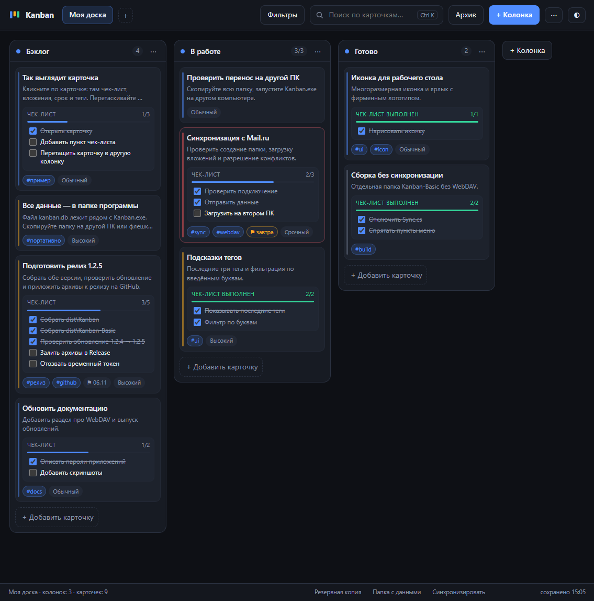
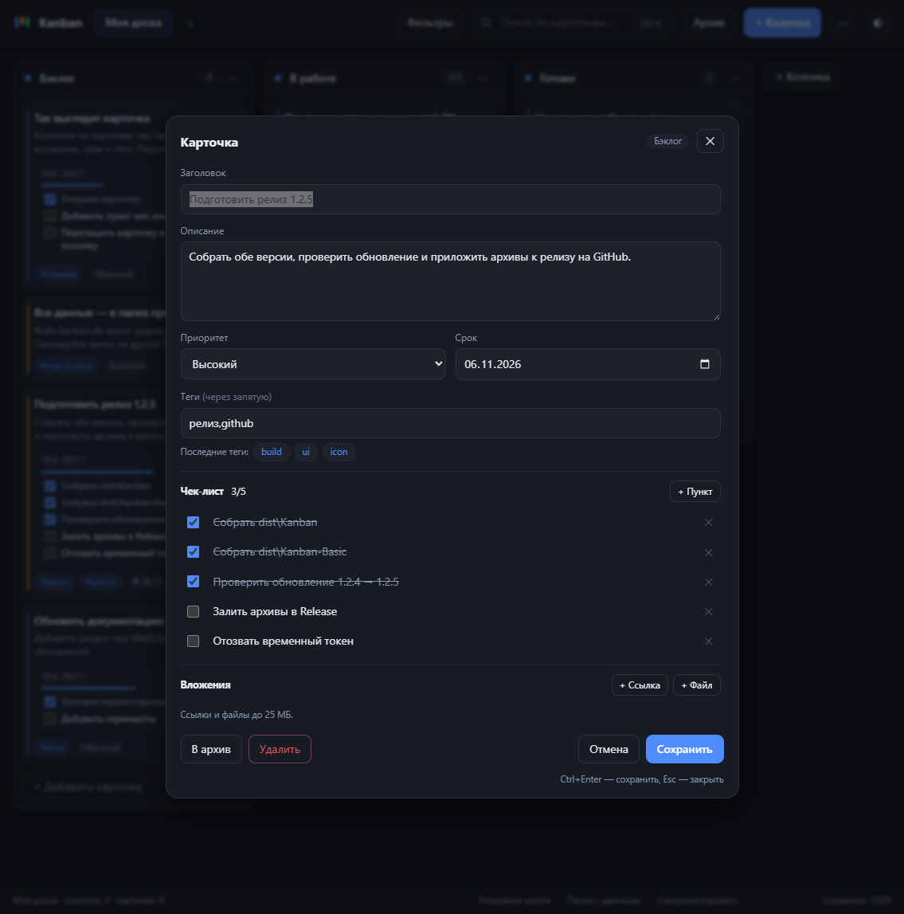
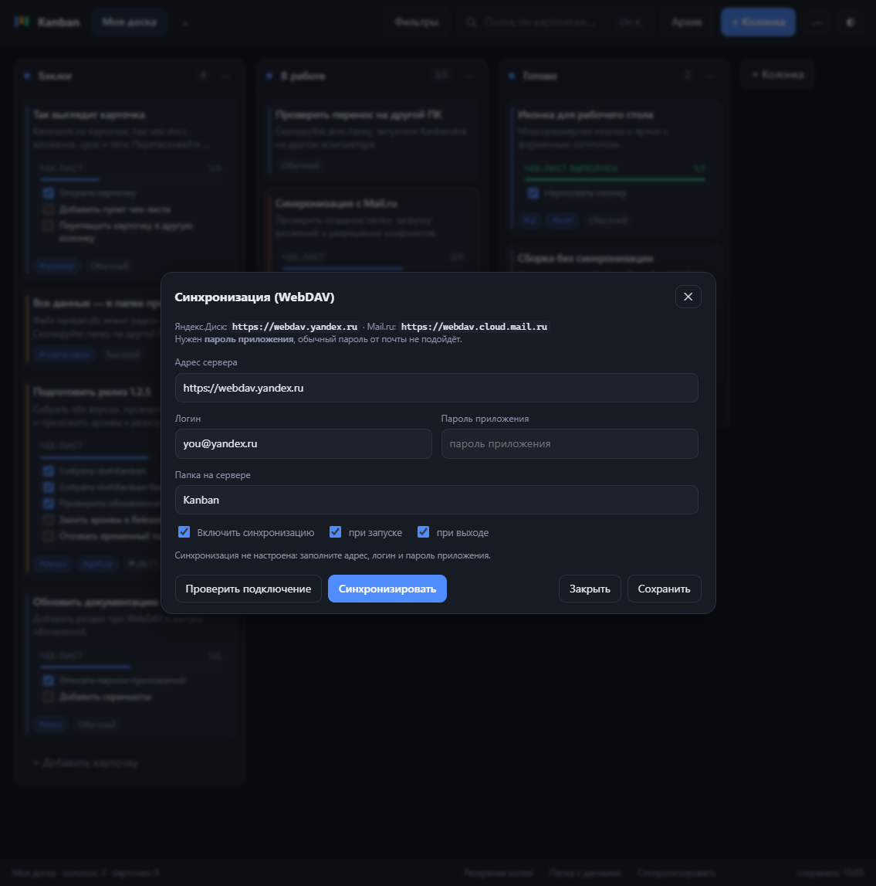
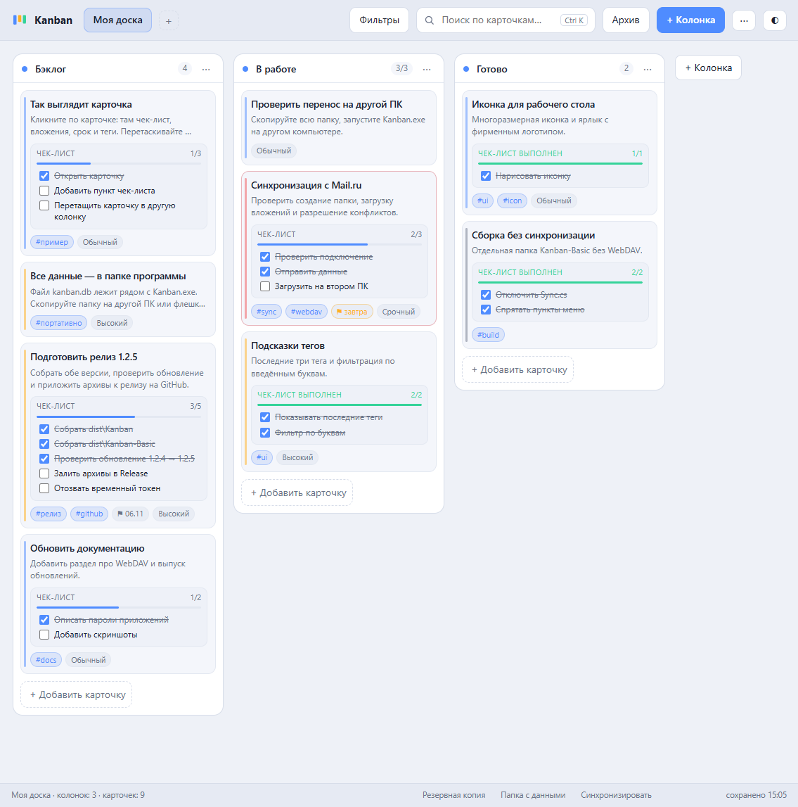

# Kanban — портативная доска задач

[Репозиторий](https://github.com/beslan-ha/kanban-portable) · [Релизы](https://github.com/beslan-ha/kanban-portable/releases) · [MIT](LICENSE)

Отдельное приложение: один `Kanban.exe`, база `kanban.db` рядом с ним, интерфейс открывается в браузере.
Ничего не устанавливает, не пишет в реестр, не требует интернета и прав администратора.
Копируется вместе с папкой на флешку или другой ПК.



## Быстрый старт

1. Запустить `Kanban.exe` (двойной клик).
2. Откроется браузер с доской. Значок приложения появится в области уведомлений.
3. Закрыть: правый клик по значку → **Выход**. Закрытие вкладки браузера приложение не останавливает.

Повторный запуск `Kanban.exe` не создаёт вторую копию — просто открывается уже работающая доска
(второй процесс сразу завершается).

Иконка для рабочего стола: дважды кликнуть **«Создать ярлык на рабочем столе.cmd»** — появится
ярлык «Kanban» с фирменной иконкой. Иконка также встроена в сам `Kanban.exe`.

## Возможности

- **Доски и колонки.** Несколько досок, переименование двойным кликом, лимит WIP для колонки.
- **Карточки.** Заголовок, описание, срок, теги, приоритет (низкий / обычный / высокий / срочный),
  перетаскивание между колонками.
- **Подсказки тегов.** Под полем «Теги» видны три последних тега — добавляются кликом мыши;
  при вводе список фильтруется по буквам («ди» → «дизайн»), выбор — стрелками с Enter.
- **Чек-лист.** Пункты с отметками; прогресс (`2/5`) и первые 5 пунктов видны прямо на карточке,
  отметить или снять отметку можно кликом по пункту — без открытия карточки. Кнопка «ещё N»
  разворачивает весь список.
- **Вложения.** Ссылки (открываются в браузере) и файлы до 25 МБ; файлы лежат в `files\`,
  скачиваются по кнопке из карточки.
- **Архив.** Кнопка «В архив» в карточке; вернуть или удалить — в диалоге «Архив».
  Архивные карточки не показываются на доске, но остаются в базе и в экспорте.
- **Фильтры.** По приоритету и по тегам (клик по тегу на карточке тоже включает фильтр).
- **Поиск** по заголовку, описанию, тегам, пунктам чек-листа и названиям вложений.
- **Экспорт:** JSON (текстом), CSV для Excel (`;` + BOM) и ZIP со всеми файлами вложений.
- **Импорт:** JSON или ZIP — заменяет содержимое базы (перед заменой создаётся резервная копия).
- **Синхронизация через WebDAV** (Яндекс.Диск, Mail.ru, Nextcloud) — перенос изменений между ПК
  при запуске, при выходе и по кнопке; см. ниже.
- **Обновления** — проверка новых версий на GitHub Releases и офлайн из папки `updates\`, см. ниже.

## Скриншоты

| Карточка с чек-листом и подсказками тегов | Синхронизация через WebDAV |
|---|---|
|  |  |

Светлая тема:



## Состав папки

| Файл / папка | Что это | Можно ли удалять |
|---|---|---|
| `Kanban.exe` | само приложение (~70 МБ: .NET 8 + веб-сервер + интерфейс внутри) | нет |
| `e_sqlite3.dll` | библиотека SQLite | нет |
| `vcruntime140_cor3.dll` | системная библиотека C++ для .NET | нет |
| `kanban.db` | **все данные**: доски, колонки, карточки, чек-листы, вложения | нет (это ваша база) |
| `files\` | содержимое файловых вложений | нет, если нужны вложения |
| `backups\` | автоматические резервные копии (по одной в сутки + вручную) | можно, но лучше не всё |
| `updates\` | файл обновления и `version.json` (появляется, когда вы кладёте туда новую версию) | можно |
| `kanban.config.json` | настройки (порт, бэкапы, обновления) | пересоздастся |
| `kanban.ico` | иконка приложения (для ярлыков) | можно, если ярлык уже создан |
| `Создать ярлык на рабочем столе.cmd` + `shortcut.ps1` | создают ярлык с иконкой | можно |
| `kanban.log` | журнал запусков и ошибок | можно |
| `sync-state.json` | служебное состояние синхронизации (появляется после первой синхронизации) | можно, но синхронизация начнётся «с нуля» |
| `runtime.json` | служебный, существует только пока приложение запущено | нет |
| `README.md` | эта инструкция | можно |

## Перенос на другой ПК / работа с флешки

1. Выйти из приложения (значок → **Выход**) — база закроется корректно.
2. Скопировать **всю папку** целиком (вместе с `files\`, если есть вложения).
3. На другом ПК запустить `Kanban.exe`.

Копировать только `Kanban.exe` нельзя: база и вложения лежат рядом, в папке приложения.

Требования к носителю: **exFAT** или **NTFS**. FAT32 не рекомендуется (лимит 4 ГБ на файл и слабая устойчивость к сбоям).
Перед извлечением флешки — «Безопасное извлечение».

## Резервные копии

- При запуске создаётся копия, если последней больше суток.
- Вручную: значок → **Создать резервную копию**, либо кнопка в нижней панели.
- Хранятся последние 30 файлов в `backups\`.
- Восстановление: выйти из приложения, переименовать текущий `kanban.db` в `kanban.db.bad`,
  скопировать нужный файл из `backups\` в корень папки и назвать его `kanban.db`.
  Резервная копия содержит базу, но не папку `files\`.

## Экспорт и импорт

Меню `⋯`:

| Пункт | Что делает |
|---|---|
| **Экспорт в JSON** | читаемый файл со всеми досками; файловые вложения в него не попадают |
| **Экспорт в CSV** | таблица для Excel (разделитель `;`, кодировка UTF-8 с BOM) |
| **Экспорт с вложениями** | ZIP: `data.json` + папка `files\` — полный перенос данных |
| **Импорт (JSON или ZIP)** | заменяет содержимое базы; формат определяется автоматически |

Перед импортом автоматически создаётся резервная копия. Битый или пустой файл отклоняется,
данные при этом не меняются.

## Синхронизация через WebDAV

Доска может хранить копию на облачном диске и переносить изменения между двумя ПК.
Одновременная работа на двух машинах не предполагается: приложение сравнивает снимки и,
если данные менялись с обеих сторон, предлагает выбрать версию.

Поддерживается любой WebDAV-сервер: **Яндекс.Диск**, **Mail.ru Облако**, Nextcloud, NAS.

### Что понадобится

| Сервис | Адрес | Пароль |
|---|---|---|
| Яндекс.Диск | `https://webdav.yandex.ru` | пароль приложения (создать в `id.yandex.ru` → Безопасность → Пароли приложений) |
| Mail.ru Облако | `https://webdav.cloud.mail.ru` | пароль для внешних приложений (Настройки → Безопасность) |
| Nextcloud | `https://cloud.example.com/remote.php/dav/files/логин` | обычный пароль или пароль приложения |

Обычный пароль от почты не подойдёт — сервисы требуют отдельный «пароль приложения».
Адрес можно вводить и с `http://` — для внешних серверов приложение само переключится на `https://`
(локальные адреса вроде `127.0.0.1` и `192.168.*` остаются как есть).

### Настройка

1. Меню `⋯` → **Настройки синхронизации…**
2. Заполнить адрес, логин, пароль приложения и папку (по умолчанию `Kanban`; создастся сама).
3. Поставить **Включить синхронизацию**, при необходимости — «при запуске» и «при выходе».
4. **Проверить подключение**, затем **Синхронизировать**.

Пароль хранится в `kanban.config.json` в зашифрованном виде (DPAPI, привязка к пользователю Windows).
При переносе папки на другой ПК его нужно ввести заново.

### Как это работает

- На сервере лежат `kanban.json` (снимок данных) и папка `files\` с вложениями.
- При запуске приложение забирает изменения с сервера, при выходе — отправляет свои.
- Кнопка **Синхронизировать** в нижней панели и пункт меню делают это вручную.
- Вложения передаются по одному и только новые — при повторной синхронизации они не качаются заново.
- Перед загрузкой данных с сервера автоматически создаётся резервная копия в `backups\`.

### Конфликты

Если данные менялись и на этом ПК, и на сервере, появится баннер с выбором:

| Кнопка | Что произойдёт |
|---|---|
| **Взять с сервера** | локальная версия заменяется серверной (текущая сохраняется в `backups\kanban-local-*.json`) |
| **Загрузить своё** | серверная версия заменяется локальной |
| **✕** | отложить решение; синхронизация не выполняется |

Локальная копия `kanban-local-*.json` содержит данные карточек (чек-листы, ссылки, имена файлов),
но не сами файлы вложений — их содержимое остаётся в `files\` до очистки неиспользуемых файлов.

При первом подключении к серверу, где уже есть данные, приложение тоже спросит, какую версию оставить.
Чтобы конфликтов не было, синхронизируйтесь перед сменой компьютера (или включите синхронизацию при выходе).

### Ограничения

- Нельзя работать на двух ПК одновременно и ждать «слияния»: изменения не объединяются построчно.
- Синхронизация идёт целиком снимком базы, поэтому при очень большой базе и медленном интернете
  передача занимает время.
- Если на сервере закончилось место, синхронизация остановится с сообщением об ошибке и ничего не испортит.

## Обновление программы

Приложение проверяет новые версии в двух местах: **GitHub Releases** (нужен интернет) и папка
`updates\` рядом с `Kanban.exe` (работает офлайн). Если версия в папке новее — она имеет приоритет.

### Обновление с GitHub

1. Меню `⋯` → **Проверить обновления** или правый клик по значку в трее.
2. Приложение запрашивает последний релиз
   [beslan-ha/kanban-portable](https://github.com/beslan-ha/kanban-portable/releases) и сравнивает
   версию с текущей.
3. Если вышла новая — сверху появляется баннер «На GitHub вышла версия …».
4. **Обновить и перезапустить** — скачивается архив именно для вашей сборки
   (`Kanban-…` или `Kanban-Basic-…`, ~66 МБ), проверяется контрольная сумма SHA-256,
   подменяются `Kanban.exe` и DLL, приложение запускается заново.

Подробности:

- результат проверки кэшируется на 15 минут — это защищает от лимита GitHub API (60 запросов в час);
- архив скачивается в папку приложения и удаляется после распаковки;
- нужны права на запись в папку программы (не Program Files и не архив);
- если интернета нет, приложение просто сообщит об ошибке и продолжит работать;
- при первом запуске после обновления временные файлы удаляются автоматически.

### Обновление из папки `updates\`

Интернет не нужен: новую версию приносит пользователь.

1. Создать рядом с `Kanban.exe` папку `updates`.
2. Положить туда новый `Kanban.exe` (например, `Kanban-1.3.1.exe`).
3. Положить туда `version.json`:

```json
{
  "version": "1.3.1",
  "file": "Kanban-1.3.1.exe",
  "notes": "Что нового — короткая строка для баннера"
}
```

4. В приложении появится баннер «В папке updates лежит версия …» → **Обновить и перезапустить**.

Приложение закроется, подменит файлы и запустится снова; `Kanban.update.exe`, `update.cmd`
и `*.update.dll` удаляются автоматически.

### Выпуск обновления (для разработчика)

1. Поднять версию **в двух местах**: `Program.cs` (`AppVersion`) и `Kanban.csproj` (`<Version>`).
2. Собрать: `pwsh -NoProfile -File .\build.ps1`.
3. Опубликовать:

```powershell
git add -A
git commit -m "Kanban 1.3.1"
git push
git tag v1.3.1
git push origin v1.3.1
```

   GitHub Actions (`.github/workflows/build.yml`) соберёт обе версии, приложит архивы к релизу
   `v1.3.1` — и все установленные копии увидят обновление.

   Офлайн-вариант: `make-update.ps1` создаёт `dist\updates\Kanban-1.3.1.exe` + `version.json`,
   эту папку копируют рядом с `Kanban.exe`.

Как убедиться, что обновление установилось:

| Проверка | Ожидание |
|---|---|
| Баннер обновления | исчез, приложение перезапустилось |
| Меню → «О приложении» | новая версия |
| `http://127.0.0.1:5183/api/health` | `"version": "1.3.1"` |
| Свойства `Kanban.exe` | новая версия файла |
| `kanban.log` | строки «Обновление 1.3.0 → 1.3.1 (github)» и «Kanban 1.3.1 запущен» |
| Папка приложения | нет `Kanban.update.exe`, `update.cmd`, `*.download.zip` |

Обновление заменяет `Kanban.exe` и, если они есть в архиве, `e_sqlite3.dll` и
`vcruntime140_cor3.dll`. Файлы данных, настройки и вложения не затрагиваются.

## Настройки (`kanban.config.json`)

```json
{
  "port": 5183,
  "openBrowser": true,
  "backupOnStart": true,
  "backupsToKeep": 30,
  "checkUpdatesOnStart": true,
  "autoApplyUpdates": false,
  "checkUpdatesOnline": true,
  "updateRepo": "beslan-ha/kanban-portable",
  "updateApiBase": "https://api.github.com",
  "updateCheckMinutes": 15,
  "sync": {
    "enabled": false,
    "url": "https://webdav.yandex.ru",
    "login": "",
    "passwordProtected": "",
    "folder": "Kanban",
    "onStart": true,
    "onExit": true
  }
}
```

- `port` — локальный порт (только `127.0.0.1`, из сети доска недоступна). Если занят, берётся следующий свободный.
- `openBrowser: false` — не открывать браузер автоматически (адрес показан в уведомлении).
- `checkUpdatesOnStart` — проверять обновления при запуске и раз в минуту.
- `autoApplyUpdates: true` — устанавливать найденное обновление без подтверждения (по умолчанию выключено).
- `checkUpdatesOnline` — проверять GitHub Releases (если `false`, работает только папка `updates\`).
- `updateRepo` — репозиторий с релизами в формате `owner/name`.
- `updateApiBase` — адрес GitHub API; менять только для тестов или своего прокси.
- `updateCheckMinutes` — как часто повторять онлайн-проверку (по умолчанию 15 минут, защита от лимита GitHub).
- `sync` — настройки WebDAV; `passwordProtected` — зашифрованный пароль, надёжнее задавать его в интерфейсе.

## Горячие клавиши

| Клавиши | Действие |
|---|---|
| `Ctrl+K` | поиск по карточкам |
| `Enter` в поле добавления | создать карточку |
| `Shift+Enter` | перенос строки |
| `Ctrl+Enter` в редакторе | сохранить |
| `Enter` в поле пункта чек-листа | сохранить пункт |
| `↑` / `↓` в поле тегов | выбрать подсказку тега |
| `Enter` в поле тегов | вставить выбранный тег |
| `Esc` | закрыть диалог/меню |
| двойной клик по названию колонки/доски | переименовать |

## Ограничения

- Один файл вложения — не больше 25 МБ (защита от переполнения флешки и памяти).
- До 200 пунктов чек-листа на карточку, до 20 тегов, имя тега до 40 символов.
- Одновременно может работать только один экземпляр на папку.

## Если что-то не так

- **Windows SmartScreen «неизвестный издатель»** — файл не подписан сертификатом. «Подробнее» → «Выполнить всё равно».
- **Приложение не открывается** — посмотрите `kanban.log`, проверьте, не занимает ли порт 5183 другая программа.
- **Доска не открылась, но процесс запущен** — правый клик по значку в трее → «Открыть доску».
- **Данные не сохранились** — проверьте, не открыта ли папка только для чтения (например, внутри архива или защищённого каталога).
- **Не скачивается вложение** — проверьте, что папка `files\` на месте и файл не удалён вручную.
- **Синхронизация: «Неверный логин или пароль»** — для Яндекс.Диска и Mail.ru нужен пароль приложения, а не пароль от почты.
- **Mail.ru отвечает 403** — это его обычный ответ на неверный пароль или на обычный пароль вместо пароля для внешних приложений (Настройки → Безопасность → Пароли для внешних приложений).
- **Синхронизация: «Пароль приложения не сохранён на этом ПК»** — папку перенесли на другой ПК; введите пароль заново в настройках.
- **Баннер «Данные менялись и на этом ПК, и на сервере»** — выберите версию; проигравшая сохраняется в `backups\kanban-local-*.json`.
- **Обновление: «GitHub вернул HTTP 403/429»** — исчерпан лимит GitHub API (60 запросов в час на IP). Подождите или увеличьте `updateCheckMinutes`.
- **Обновление не устанавливается** — папка программы только для чтения либо антивирус блокирует замену exe. Проверьте `kanban.log`.
- **Нет интернета** — обновление с GitHub недоступно; используйте офлайн-папку `updates\`.
- **После обновления старая страница** — обновите вкладку (`F5`); приложение отдаёт файлы интерфейса без кэширования.

## Сборка из исходников

```powershell
pwsh -NoProfile -File .\build.ps1
```

Собираются две папки:

| Папка | Что внутри |
|---|---|
| `dist\Kanban` | полная версия с WebDAV-синхронизацией |
| `dist\Kanban-Basic` | версия без синхронизации (собирается с `-p:NoSync=true`) |

Только основная версия: `pwsh -NoProfile -File .\build.ps1 -FullOnly`.
Иконка лежит в `assets\kanban.ico` и встраивается в `Kanban.exe`.

## Лицензия

[MIT](LICENSE) © 2026 beslan-ha.
